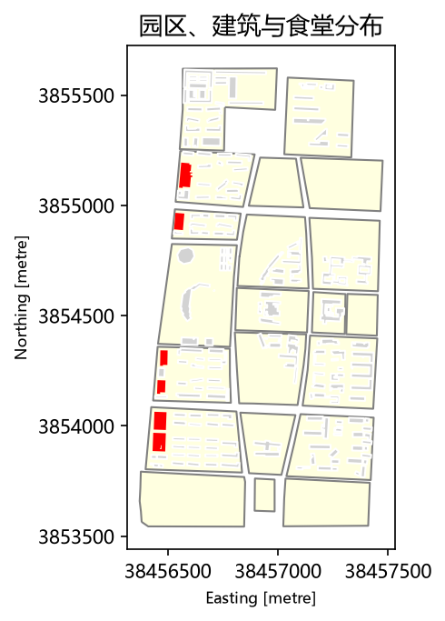
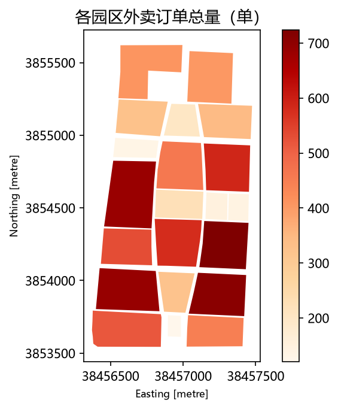
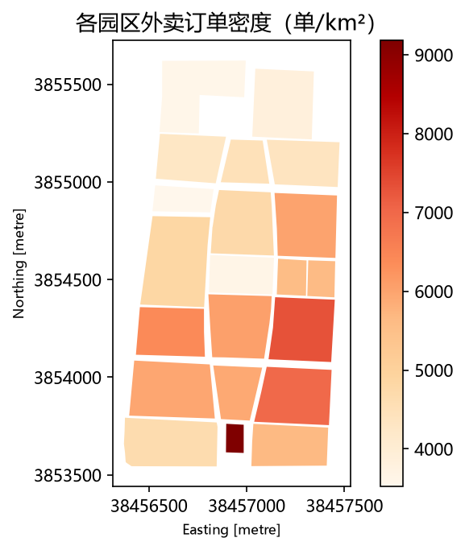
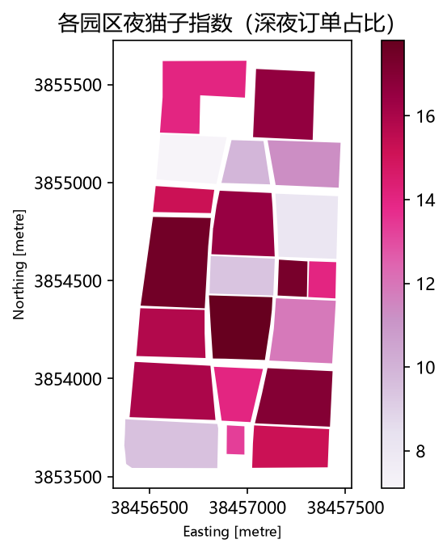

# 郑州大学校园外卖订单空间分析

> 用 Python（geopandas）对郑州大学校园外卖订单数据做空间分析：谁点的最多、哪里密度最高、深夜订单反常在哪里、每栋楼属于哪个园区。



## 1. 研究问题

外卖订单在校园里不是均匀分布的。本研究用四个视角观察这种不均衡：

1. **总量**：哪个园区订单最多？
2. **密度**：单位面积上哪里订单最旺？（总量高 ≠ 密度高）
3. **时段**：哪些园区深夜订单反常地多？
4. **归属**：每栋建筑属于哪个园区？（用空间连接自动判断，并与底图标注核对）

## 2. 数据

| 图层 | 内容 | 要素数 |
|---|---|---|
| `areas` | 园区面 | 21 |
| `buildings` | 建筑面 | 205 |
| `shitang` | 食堂面 | 6 |

- 坐标系：EPSG:4526（CGCS2000 / 3 度带，米制，可直接计算面积与距离）
- **园区 / 建筑 / 食堂的几何边界来自真实校园底图**
- **订单统计为脚本内模拟数据**（`analysis.py` 第 2 步生成，随机种子固定为 42，任何人运行结果完全一致）。数值量级参照真实校园外卖数据，因数据授权限制不使用真实订单，本项目的重点在于展示**可复现的空间分析方法**。

## 3. 如何运行

```bash
pip install -r requirements.txt
python analysis.py
```

需要 Python 3.10+。所有输出图片自动保存到 `output/` 文件夹。

## 4. 分析结果

### 4.1 总量 ≠ 密度

订单总量最高的园区是**理科园**（724 单），但订单密度最高的却是**五星广场**（9184 单/km²）。这说明：**看绝对量选出来的"热点"和看强度选出来的"热点"不是同一批地方** —— 大园区单多可能只是因为它大。做选址类分析时必须先想清楚要回答的是哪个问题。




### 4.2 深夜订单反常的园区

以全校平均夜猫子指数（13.7）为锚点，21 个园区中有 13 个高于平均，其中**南核心教学楼**（17.8）显著突出，前 3 名全是教学楼、体育场、图书馆这类功能区。

一个合理的解释假设：深夜外卖需求集中在**晚自习 / 考研自习人流大的功能区**，而不是宿舍区 —— 宿舍区门禁较早，同学回宿舍后点外卖的窗口变短。这一假设在模拟数据上只能作为方法演示，需要真实数据才能验证，但"先看数据形态、再提机制假设、最后用数据检验"正是本分析想展示的工作方式。



### 4.3 空间连接：205 栋楼的归属自动确认

用 `gpd.sjoin`（规则：相交）自动判断每栋楼属于哪个园区，结果与底图标注 **205/205 完全一致**。

> 分析过程中的一个发现：真实项目里有一栋楼 99% 位于园区内、0.9% 跨出边界，用严格的 `within` 规则会被判为"不属于任何园区"，改用 `intersects` 后与人工标注一致。**空间关系判断规则（predicate）的选择会直接改变结论。**

## 5. 技术栈

- Python 3.12 · geopandas · shapely · pyogrio · matplotlib
- 分析流程：数据读取 → 指标计算（密度/占比） → 布尔筛选 → 空间连接（sjoin） → 分级设色专题地图（choropleth）

## 6. 局限与改进方向

1. **订单数据为模拟数据**，仅用于展示分析方法，具体数值不具备真实参考价值；若获得真实数据授权，只需替换 `data/` 中的属性表即可复用全部代码。
2. **图片没有标注园区名称**，非本校师生读图需要对照底图，后续可用 `ax.annotate` 或 `adjustText` 库给每个面加注名称。
3. **夜猫子指数在小样本园区上可能虚高**：总单量少的园区，个别几单深夜订单就能显著拉高占比，比较时应同时参考绝对量。
4. 可引入 POI 数据做设施可达性分析，检验"离食堂越远、外卖密度越高"的假设。

---

*本项目为学习作品，欢迎交流。*
